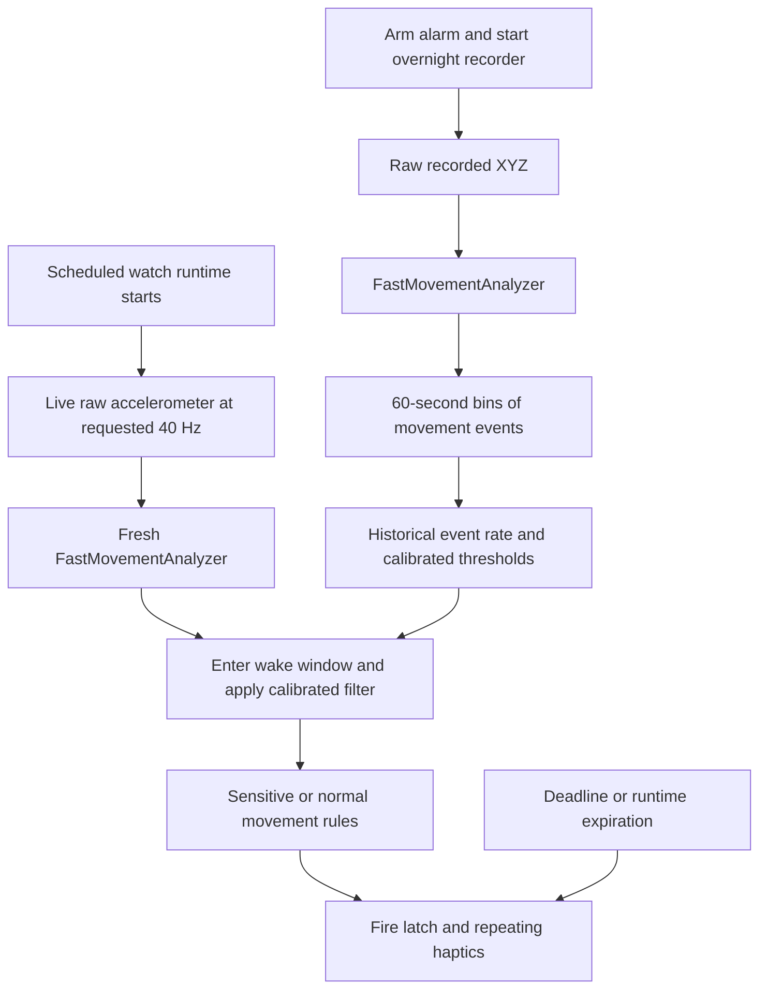

# Sleep Cycle: recovered watch smart-wake algorithm

**The actual watch executable has been decrypted, and its smart-wake algorithm has been reconstructed and checked against the original instructions.** This report applies to the supplied Sleep Cycle **6.26.430, build 28530**. It supersedes the earlier encryption-limited report and the separate phone-SDK hypothesis.

The watch uses an accelerometer movement detector, overnight movement-event calibration, and a timed rule system. The traced wake path does not use heart rate, HRV, temperature, Apple sleep-stage labels, or a neural-network sleep-stage classifier. Its proxy for a favorable wake moment is qualifying wrist movement.

## Deliverables and completion

- [x] Decrypt both ARM64 and ARM64_32 watch slices.
- [x] Verify every protected watch page against both original pre-encryption hash tables.
- [x] Trace raw motion, overnight recording, event aggregation, calibration, phases, and wake rules.
- [x] Execute original instructions and compare their results with independent reconstructions.
- [x] Document scheduling, deadline protection, and haptic escalation.
- [x] Supply a readable reference implementation and repeatable verification tools.
- [x] Remove the temporary iPhone helper and preserve the original IPA.

| Artifact | Contents |
| --- | --- |
| [MOTION.md](MOTION.md) | Exact live and recorded input processing, detector pseudocode, constants, event bins, architecture parity |
| [ALARM.md](ALARM.md) | Complete wake decision, historical calibration, parameter table, state and strict/inclusive boundaries |
| [RUNTIME.md](RUNTIME.md) | Recorder setup, runtime scheduling, history cursor, deadline/expiration paths, haptics |
| [WatchAlgorithmReference.py](WatchAlgorithmReference.py) | Independently written executable model of the recovered mathematics and state |
| [PROBES.md](PROBES.md) / [watch-proof.json](watch-proof.json) | Reproduction commands, original-instruction checks, coverage and limitations |
| [DECRYPTION.md](DECRYPTION.md) / [decryption-proof.json](decryption-proof.json) | How plaintext was recovered and independently authenticated against the IPA |
| [evidence.json](evidence.json) | Original package metadata plus the current investigation result |

## How the actual algorithm works



### 1. Turn raw acceleration into movement

The detector consumes raw X/Y/Z acceleration, including gravity. For each sample it compares the vector with the previous sample and a saved reference refreshed every **100 samples**. A Euclidean displacement **strictly above 0.09000000000000001** qualifies as instantaneous movement.

Separately, it averages each axis in successive, nonoverlapping **301-sample blocks**. If the largest absolute axis change between consecutive block means exceeds **0.0040395260551327715**, it reports delayed movement. This threshold is computed as:

```text
R = exp((D - 0.327) / 0.043) × (2.1 if D < 0.04 else 1)
D = 0.09000000000000001
```

A nonqualifying sample more than **10 seconds** after the last qualifying sample resets the detector's movement-episode latch. The detailed update order matters: a block-mean hit overwrites instantaneous intensity, and a timestamp gap alone does not reset the analyzer. Full pseudocode and these edge cases are in [MOTION.md](MOTION.md).

Live processing requests 40 Hz; modern-watch recorded history consumes every returned sample at the recorder's delivered cadence. At exactly 40 Hz the 100-sample reference and 301-sample block correspond to 2.5 and 7.525 seconds. They are sample counts, not time-based windows.

### 2. Adapt to movement during that night

Recorded analyzer output becomes events in **60-second bins**: up to one ordinary and one delayed movement event per bin. Each carries the **last** qualifying intensity of its kind, even though the stored field is named “strongest.” It does not count every individual movement.

Let S be sleep-session start and E be its explicit end, otherwise the latest event date. The historical counting interval begins at:

```text
C = max(S, min(S + 2 hours, E - 3 hours))
rate = qualifying event count / ((E - C) in hours)
```

Zero-duration history returns **9.5 events/hour**. For a **30-minute wake window**, a rate below **7** selects very-sensitive mode. Above **9.5**, provided the full session spans at least **two hours**, the app calibrates separate ordinary and delayed intensity thresholds with a **41-step binary search** to retain approximately the target event rate. Shorter sessions keep the extra filter thresholds at zero. Between those boundaries it uses ordinary mode without extra filtering. Other window sizes have their own exact table in [ALARM.md](ALARM.md).

This adaptation changes a downstream movement filter. The initial analyzer's approximately 0.09 threshold stays fixed in the recovered live/history construction paths.

### 3. Decide when to wake

Both internal phase dates equal `alarmTime - wakeWindow`. The first movement notification strictly after that date can advance through both preliminary phases into armed. A notification exactly at the boundary does not arm it.

After applying the calibrated filter:

- **Very-sensitive mode:** any active movement fires the alarm.
- **Ordinary mode, new movement:** compute `progress = 1 - secondsUntilAlarm / wakeWindowSeconds`. If `progress × intensity > 0.02`, save this movement's start. If a prior saved start is less than **120 seconds** earlier, fire.
- **Ordinary mode, ongoing movement:** non-new, non-delayed active movement fires once more than **10 seconds** have elapsed since the saved decision start.
- **Delayed movement:** a non-new delayed event above **0.1** can seed the saved decision start if none exists. It does not fire through that branch by itself. This seeding branch can still run when filtering has cleared the active flag but retained the delayed flag and intensity.

The armed filter separately recalculates whether a movement is new using a **strictly greater than 10-second** gap between accepted samples. This is distinct from the upstream detector latch and the decision's saved start time.

For example, with a 07:00 alarm, a 30-minute window, and ordinary mode, an isolated movement of intensity 0.12 at 06:45 qualifies because `0.5 × 0.12 > 0.02`. A second qualifying episode at 06:46:15 fires because it begins 75 seconds after the saved start, less than 120. Continuous accepted movement can instead take the ongoing-movement branch. This is an illustrative execution of the recovered rules, not a claim about the user's sleep stage.

### 4. Preserve an alarm deadline and alert execution

Before the movement-specific rules, the armed decision fires when the runtime has **less than 300 seconds remaining**, or when the movement timestamp is **strictly later than the alarm time**. A separate runtime-will-expire callback can alert without a movement notification.

The selected 30-minute window schedules runtime 30 minutes before the alarm; the other offered windows schedule it 25 minutes before, with near-now clamps. Firing invokes the system repeating haptic API, cycles a recovered pattern, and escalates to retry haptics at 0.5-second intervals after its pattern accumulator exceeds 60 seconds. See [RUNTIME.md](RUNTIME.md) for the exact guards and the consequence of the five-minute runtime reserve.

## Why this result is stronger than the earlier investigation

The simulator route was actually tested and returned ciphertext. The successful route used a small development-signed helper on the licensed iPhone to obtain decrypted mapped pages. Both watch architectures were recovered. Each architecture's **540 protected 4 KB pages matches both the original SHA-1 and SHA-256 pre-encryption tables**. A deliberately changed-byte control is rejected. The same technique recovered the phone SDK's protected region byte-for-byte equal to its known public plaintext. [Decryption evidence](DECRYPTION.md)

The probes then execute the recovered watch instructions in ARM64 emulation and compare results with independent Python models. They cover the detector, window table, filter, movement decisions, historical rates, binary-search calibration, phases, deadline, expiration and firing suppression. Foundation/Swift/OS services are shimmed. The precise current case counts are in [watch-proof.json](watch-proof.json); the detailed boundaries are in [PROBES.md](PROBES.md).

ARM64_32 was decrypted and separately inspected for the user's watch architecture. Architecture parity inspection and ARM64 instruction execution are distinguished in the detailed reports. This is a reconstruction of compiled behavior, not recovered original Swift source or a completed overnight accuracy/battery trial.

The separate phone SleepCycleSDK uses a different pipeline. Its earlier formulas remain in [SDK-NOTES.md](SDK-NOTES.md) and its 116 arithmetic checks remain in [sdk-proof.json](sdk-proof.json). They are not used as a substitute for this watch implementation. [simulator-proof.json](simulator-proof.json) retains the unsuccessful simulator experiment for provenance.

## Applying the findings to Lights Timer

The relevant architecture is already present in Lights Timer: overnight `CMSensorRecorder`, a bounded extended runtime, live motion, persisted scheduling, and light handoff. The recovered reference now provides a concrete detector and decision system that can be ported and compared against the existing `WakeHeuristicEngine` on identical recordings.

The integration needs one coherent raw-XYZ processing path for both recorder and live samples, actual sample timestamps, event-bin state, a historical event-rate filter, and an alarm state machine. Maintain sample-count semantics deliberately: changing the live rate from 40 Hz to 10 Hz while retaining 100/301 counts changes detector timing by four times. Recorder and live analyzers also begin with separate state.

At research completion, an existing issue still needed correction (now fixed by the production raw-XYZ port): Lights Timer currently compares recorder raw acceleration magnitude (including gravity, roughly 1 g at rest) with live `userAcceleration` (gravity removed). [BaselineProbe.swift](BaselineProbe.swift) reproduces a zero stillness-break score for that mismatch. The recovered Sleep Cycle pipeline avoids that particular representation mismatch by processing raw XYZ consistently, then applying differences and event logic. The production integration implements that representation change separately from the historical research evidence.

Keep Lights Timer's exact-time HomeKit fallback and ownership acknowledgement during any detector replacement. Evaluate the reference on replayed raw sensor data first, then test overnight sensor delivery, relaunch, power consumption and actual wake experience. No production Swift behavior was changed during this investigation; the deliverable is the recovered specification, runnable reference, and verification suite.

## Production integration

The independent Swift port is now the production Smart Wake decision. See [IMPLEMENTATION.md](IMPLEMENTATION.md) for architecture, explicit runtime/delivery policy, schema migration, new-port validation and remaining physical-device checks. The historical research results above remain separate evidence for the reconstruction.
